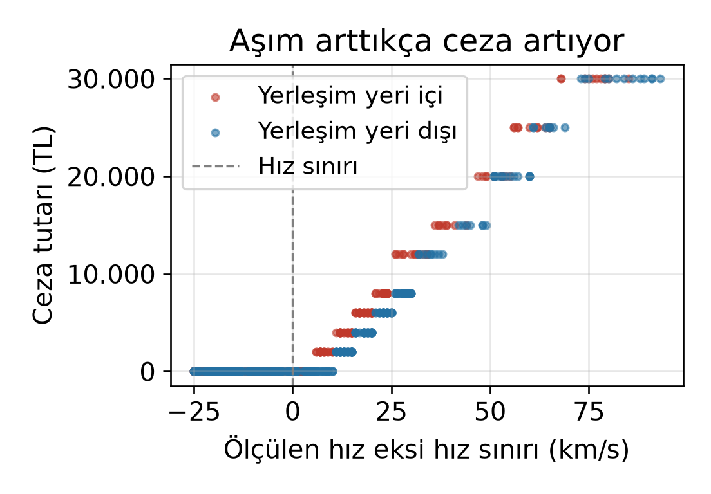

# Hız Cezası Tahmini: Ceza Yer miyim, Yersem Ne Kadar?

[](https://colab.research.google.com/github/AxelXoket/speeding-fine-predictor/blob/main/speeding_fine_prediction.ipynb)

Radara yakalanan bir sürücünün ceza alıp almayacağını, alırsa kaç TL ödeyeceğini ve ehliyetinin geri alınıp alınmayacağını tahmin eden uçtan uca bir Python projesi. Veri temizliğinden karar ağacı modeline, kanunla karşılaştırma adımından klavyeden soru soran mini uygulamaya kadar her adım tek bir not defterinde çalışır.

Yapay Zeka İçin Basitleştirilmiş Python eğitiminin bitirme projesidir ("Uçtan Uca Yapay Zeka Projesi: Veriden Tahmine").



## Sonuçlar

| Model | Kullandığı bilgi | Test doğruluğu | Kanunla uyum |
|---|---|---|---|
| Model A | Ham sütunlar: araç, yol, hava, hız sınırı, ölçülen hız, saat | %86,5 | %76,3 |
| Model B | Sınırın kaç km/s aşıldığı ve yerleşim yeri içi mi | %99,3 | %96,9 |

"Kanunla uyum", modelin 7 araç tipi, 4 yol tipi ve sınırın 25 km/s altından 95 km/s üstüne kadar her hız için (3.388 durum) kanunla aynı cezayı verdiği durumların oranıdır. Model B, 3.388 durumun 105 tanesinde kanundan ayrılıyor; bu durumların hepsi eğitimde görülmemiş girdilerde ve hepsi bir kademe sınırına en çok 2 km/s uzaklıkta. Eğitimde gördüğü girdilerde uyumu %100, eğitim satırlarında hiç geçmeyen (aşım, yerleşim yeri içi mi) çiftlerinde %89,7 (bu girdilerin payı %30,2). Kanunda yerleşim yeri içi ve dışı için 9'ar kademe var; Model B, kanundaki 18 kademe sınırından 13 tanesini tam yerinde, yani sınırın iki yanında kanunla aynı cezayla buluyor. 10 farklı veri tablosunun ortalamasında, eğitim verisi 6.000 kayda çıkınca uyum %100 oluyor; bu boyutta görülmemiş girdi payı %1,4, yani bu sayının çoğu verinin her durumu kapsamasından geliyor. Görülmemiş girdilerdeki uyum 300 kayıtta %87,3, 600 kayıtta %94, 1.500 kayıtta %97,2, 3.000 kayıtta %96,3, 6.000 kayıtta %100. Seri genel olarak yükseliyor ama düz bir çizgide değil; 6.000 kayıttaki oran çok az girdiden ölçülüyor.

Ana ders: aynı algoritma, aldığı bilgiye göre ya eğitim verisini ezberliyor ya da kanunun kuralına yaklaşıyor.

## Veri

Kişi bazında gerçek ceza kayıtları kamuya açık olmadığı için veriyi kurallardan ürettim. Kural bilindiği için kanun bu projede sınavın cevap anahtarı: soru, modelin kuralı örneklerden ne kadar doğru öğrendiği. Üretim kodu (`speeding_fine/dataset.py`): araç tipi, yol tipi ve ölçülen hız rastgele seçilir, ceza ve ehliyet yaptırımı kanundan hesaplanır. Temizleme adımının gerçek bir işi olsun diye satırların bir kısmı bilerek bozulur. Temizlikte silinenler: 6 boş hız, 3 imkânsız hız, 8 tekrar eden satır. Düzeltilenler: 15 boş hava durumu ("bilinmiyor" olur), 12 yazımı bozuk metin. Sonuç `data/speeding_records.csv` dosyasındaki 608 satırdır; temizlikten sonra 591 satır kalır.

Sütunların anlamı not defterindeki veri sözlüğünde.

## Kurallar ve kaynaklar

| Konu | Dayanak |
|---|---|
| Ceza kademeleri ve tutarları | 2918 sayılı KTK madde 51/2; 7574 sayılı Kanun madde 14 ile değişik ([Resmî Gazete 27.02.2026, sayı 33181](https://www.resmigazete.gov.tr/eskiler/2026/02/20260227-0.htm)) |
| Ehliyet geri alma (30, 60, 90 gün) | KTK madde 51/3 ve 51/4 ("her seferinde") |
| Varsayılan hız sınırları | [Karayolları Trafik Yönetmeliği madde 100](https://www.mevzuat.gov.tr/MevzuatMetin/yonetmelik/7.5.8182.pdf), römorksuz araçlar; motosiklet L3 sınıfı |
| Ödeme süresi ve erken ödeme indirimi | KTK madde 115/1: tebliğden sonra 1 ay içinde ödenir; Kabahatler Kanunu madde 17/6: süresinde ödenirse %25 indirim |

| Aşım (km/s), yerleşim yeri içi | Aşım (km/s), yerleşim yeri dışı | Ceza | Ehliyet |
|---|---|---|---|
| 6-10 | 11-15 | 2.000 TL | |
| 11-15 | 16-20 | 4.000 TL | |
| 16-20 | 21-25 | 6.000 TL | |
| 21-25 | 26-30 | 8.000 TL | |
| 26-35 | 31-40 | 12.000 TL | |
| 36-45 | 41-50 | 15.000 TL | |
| 46-55 | 51-60 | 20.000 TL | 30 gün |
| 56-65 | 61-70 | 25.000 TL | 60 gün |
| 66 ve üstü | 71 ve üstü | 30.000 TL | 90 gün |

Bilinen sınırlar:

- Yönetmeliğin 101. maddesinde, sınırı %10'a kadar aşana işlem yapılmayacağını söyleyen ve hâlâ yürürlükte olan bir cümle var. Kanunun km/s kademeleriyle çeliştiği yerde kanunu esas aldım.
- Tutarlar kanunda sabit rakamla yazılı. KTK Ek Madde 3 ve Kabahatler Kanunu 17/7'den okuduğum kadarıyla 1 Ocak 2027'den itibaren her yıl yeniden değerleme oranıyla artacaklar; bunu doğrulayan resmî bir duyuru bulamadım. Tutarlar değişince `speeding_fine/rules.py` güncellenip veri yeniden üretilmeli.
- Yönetmeliğin 100. maddesi, hız sınırlayıcı bulundurması zorunlu otobüs ve minibüslerde bu cihazı 110 km/s'e, kamyon ve çekicilerde 99 km/s'e ayarlatıyor. Veri üretici bu sınırlayıcıyı hesaba katmıyor; temiz veride sınırlayıcı çalışırken görülemeyecek hızda 34 kayıt var. Not defterindeki örnekleri bu yüzden otomobil, panelvan ve motosikletten seçtim.
- İçişleri Bakanlığının otomobiller için yerleşim yeri dışında 20 km/s'e kadar artırabildiği sınırlar, levhayla değiştirilmiş yerel hız sınırları, ölçüm hatası ve son ihlalden geriye bir yıl içinde beşinci kez geri alınan belgelerin iadesi için öngörülen psiko-teknik değerlendirme ve psikiyatri muayenesi şartı modelde yok.

## Çalıştırma

En kolayı yukarıdaki Colab düğmesi: ilk kod hücresi bu depoyu indirir, gerisi sırayla çalışır. Aşama 6'da örnek bir çalıştırma var; son hücre araç tipini, yol tipini ve hızı size sorar.

Yerelde:

```bash
pip install -r requirements.txt
python -m speeding_fine.dataset          # data/speeding_records.csv dosyasını yeniden üretir
python tools/build_notebook.py           # not defterini kurar, çalıştırır, figures/ klasörünü yazar
```

## Testler

```bash
python -m unittest discover -s tests        # hızlı testler, Windows'ta 2 saniyenin altında
python -m unittest discover -s slow_tests   # not defterini geçici bir kopyada baştan sona çalıştırır
python tools/mutation_check.py              # kodu bilerek bozar, testlerin yakaladığını gösterir (yaklaşık 8 dakika)
```

Rapor (Edge ile PDF) ve sunum (Calibri ile satır genişliği ölçümü) Windows'ta üretilir. Calibri yoksa sunum testleri sebebini yazarak atlanır; diğer testler her sistemde çalışır.

- `tests/`: kanun ve yönetmelikten elle yazılmış senaryoları sınar (her kademe sınırının iki yanı, 7 araç × 4 yol). Ayrıca şunları denetler: hız 1'den 300 km/s'e çıkarken ceza hiç düşmüyor, hatalı girdiler reddediliyor, veri üreticisi aynı tohumla aynı tabloyu veriyor, bozulan satır sayıları tam bildirilen kadar, depodaki CSV üreticinin çıktısıyla bayt bayt aynı, README'deki sayılar ölçülenle aynı, sunumda kutusuna sığmayan satır yok ve hiçbir metin dosyasında kontrol karakteri ya da uzun tire yok.
- `slow_tests/`: not defterinin kodu ne üretiyorsa onu sınar: temizlikten kalan satırlar, skorların kanuna karşı bağımsız yeniden sayımı, görülmemiş girdi ve kademe sınırı ölçümlerinin bağımsız yeniden sayımı, hataların kademe sınırlarına yakınlığı, kayıtlı örnek oturumun cevapları, öğrenme eğrisi, uygulamanın Türkçe adları ve hatalı girdileri nasıl karşıladığı, Colab'daki depo indirme yolu.
- Testlerin gerçekten koruyup korumadığını `tools/mutation_check.py` ölçer: kuralları, veri üreticisini, rapor ve sunum üreticisini, README'yi ve not defterini tek tek bozan 83 değişikliğin hepsini testler yakalıyor. Betik projeyi geçici bir kopyaya alır, çalışma klasörüne dokunmaz. Bozmaların listesi `tools/mutants.json` dosyasında; hızlı testler bu listenin güncel kaldığını denetler.

## Proje yapısı

```
speeding_fine/rules.py          2026 ceza kademeleri, hız sınırları, erken ödeme
speeding_fine/dataset.py        kurallardan veri üretimi ve bilerek bozma
data/speeding_records.csv       üretilmiş veri seti
speeding_fine_prediction.ipynb  çalıştırılmış not defteri (Colab)
tools/build_notebook.py         not defterinin kaynağı
tools/build_deliverables.py     rapor (PDF) ve sunum (PPTX) üreticisi
tools/mutation_check.py         bozma denemesi (mutasyon testi)
figures/                        grafikler ve metrics.json
docs/                           rapor ve sunum
tests/, slow_tests/             testler
```
